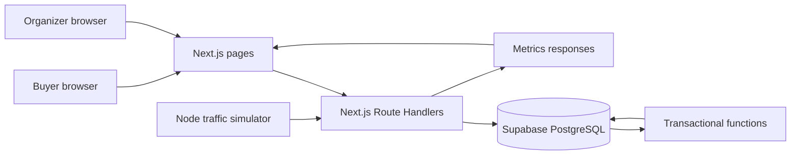

# Fair Drop — Website Architecture

For an implementation sequence that can be followed across separate chats, see the [six-phase plan](phases/README.md).

## 1. Purpose and scope

Fair Drop is a hackathon prototype for a limited ticket sale where many buyers compete for a small inventory. The source problem frames this as **500 seats for 50,000 people**. The prototype must show that request speed or repeated requests do not, by themselves, give one account extra entries or tickets, and that concurrent requests cannot oversell inventory.

**Build strategy:** first implement the established virtual waiting room and ticket checkout experience. After that vertical slice works, add features that make Fair Drop's fairness visible and testable. A six-hour build should cover **one event, one ticket type, one ticket per account, and simulated payment**.

The attached `FairDrop.md` is a project brief. Its implementation suggestions are recommendations, not organizer rules. The original organizer PDF was not provided here, so confirm submission and judging requirements separately. Any 50,000-user capacity claim requires an actual test at that scale; a simulator showing 50,000 logical buyers is not the same as 50,000 concurrent browser connections.

### Success conditions for the prototype

- A buyer completes event page → waiting room → queue → admission → reservation → confirmation.
- Rejoining or refreshing returns the same authoritative account state.
- A user has at most one eligible queue entry and one confirmed ticket per event.
- `available + reserved + sold = total_inventory` after every state transition.
- Concurrent reserve/confirm requests produce no oversells or duplicate orders in the tested scenarios.
- A repeatable simulation compares ordinary users with retrying or flooding clients, with configuration and limitations shown.

## 2. Product surfaces

| Surface | Route (suggested) | What it contains |
|---|---|---|
| Buyer event page | `/events/[eventId]` | Event details, countdown, inventory summary, queue policy, join button |
| Buyer queue and checkout | `/events/[eventId]/queue` | Current state, position/people ahead, status refresh, reservation timer, simulated checkout, result |
| Organizer dashboard | `/admin/events/[eventId]` | Sale controls, inventory, queue/admission counters, errors, recent decisions |
| Fairness Lab | `/admin/events/[eventId]/lab` | Simulation controls, baseline comparison, outcome charts and limitations |

The buyer page should show the server's state. It must never decide its own position, admission, inventory, or successful order.

## 3. Feature sequence

### Phase A — established features to implement first

These are patterns already described in commercial ticket queues and waiting rooms. Fair Drop should not claim to have invented them.

| Priority | Feature | Buyer/organizer behavior | Reference pattern |
|---|---|---|---|
| P0 | Event page and scheduled entry window | Display opening/cutoff times and published queue policy | Ticketmaster waiting room; Queue-it scheduled sales |
| P0 | One stable queue entry | Joining twice returns the existing entry; refresh restores it | Queue products use account/visitor identity and queue state |
| P0 | Server-assigned queue order | Randomize eligible entries once when entry closes; late users go behind the frozen set | Queue-it pre-queue randomization followed by ordered admission |
| P0 | Controlled admission | Admit a configurable number of buyers at a time; show queue progress | Queue-it traffic flow controls; Queue-Fair waiting room |
| P0 | Reservation timer and checkout | Hold one ticket briefly; confirm simulated payment or return it to stock | Ticketmaster checkout time limit |
| P0 | Basic abuse responses | Throttle excessive requests and reject token reuse with clear messages | Queue-it bot and abuse controls |
| P0 | Organizer counters | Show available/reserved/sold, queued/admitted, and throttled requests | Waiting room monitoring and reporting |

**References:** [Ticketmaster queue](https://help.ticketmaster.com/hc/en-us/articles/9781366115985-What-is-the-queue-and-how-do-I-join), [Ticketmaster checkout timer](https://help.ticketmaster.com/hc/en-us/articles/9642204793617-Why-is-there-a-time-limit-for-checking-out), [Queue-it scheduled queue behavior](https://queue-it.com/how-does-queue-it-work/), [Queue-it abuse controls](https://queue-it.com/developers/bots-abuse-management/), [Queue-Fair waiting room](https://queue-fair.com/en-us/).

### Phase B — Fair Drop demo additions

Implement only after the Phase A flow is complete and concurrency checks pass.

| Priority | Feature | Value | Minimum implementation |
|---|---|---|---|
| P1 | Fairness Lab | Makes the claim measurable | Run ordinary, same-account retry, and flood profiles; show allocations and request counts |
| P1 | Buyer fairness receipt | Makes an individual outcome understandable | Display accepted entry time, ordering policy, final position, admission and purchase outcome, and reason codes |
| P1 | Baseline comparison | Shows what the controls changed | Re-run the same seeded logical population using a simple first-request-wins model, clearly labeled as a simulation |
| P2 | Explainable rejection feed | Shows abuse rules' effect on real users | Show counts and reasons for duplicate, throttle, expired token, and sold-out results |
| P2 | Live inventory invariant indicator | Makes correctness visible | Reconcile available/reserved/sold and show pass/fail on the dashboard |

These are **proposed demonstration strengths**, not verified gaps in competitor products. Do not build a second marketplace, real payments, facial recognition, or opaque “AI bot detection” during this hackathon.

## 4. Recommended technical stack

| Layer | Technology | Reason and boundary |
|---|---|---|
| UI and API | Next.js App Router + TypeScript | One repository for buyer pages, admin pages, and HTTP Route Handlers |
| Styling | Tailwind CSS | Quick responsive layout; plain components are fine |
| Database | Supabase PostgreSQL | Managed durable state for events, queue entries, reservations, orders, and audit records |
| Critical transitions | PostgreSQL functions, called from server-side API code | Keep multi-row inventory changes inside one database transaction; Supabase supports calling functions through `rpc()` |
| Live state | HTTP polling every 2–3 seconds | Fewer moving parts than SSE/WebSockets for a six-hour prototype |
| Charts | Recharts | Simple dashboard charts; plain tables are acceptable if time is short |
| Simulator | Node.js + TypeScript using `fetch` | Exercises the same HTTP API used by buyers; no second backend |
| Tests | Vitest and a small concurrent API test script | Verify invariants and retry behavior |
| Deployment | Vercel + Supabase | Convenient hosted demo after the local end-to-end flow works |

Use a database function or one explicit SQL transaction for each reserve/confirm/expiry transition. **Do not** read inventory in one API request and write it back in another. Supabase database functions are documented at [Supabase Database Functions](https://supabase.com/docs/guides/database/functions); Next.js Route Handlers are documented at [Next.js Backend for Frontend](https://nextjs.org/docs/app/guides/backend-for-frontend).

Redis, SSE, WebSockets, a job queue, and real payment integration are optional follow-ons. If the team already knows another framework or database much better, preserve the state machine and transaction rules below while using that familiar stack.

## 5. High-level system diagram



The simulator labels each test client and run. That metadata is for evaluation only; a real buyer cannot set trusted queue position, inventory, or order status through the API.

## 6. Identity, roles, and trust boundaries

### Demo identity

Seed a fixed set of demo accounts. A buyer selects or receives one test account and the server sets an **HTTP-only, signed session cookie**. The server reads account identity from that cookie, not from a submitted `userId`. Use a separate organizer login or secret-backed admin session. Never expose a Supabase service-role key to the browser.

This is a demonstration identity policy, not strong proof that each account belongs to one human. Clearing cookies, obtaining another demo account, or using many real accounts is outside the protection of this prototype. The Fairness Lab should include a multi-identity scenario only if there is time, and should present it as a known limitation.

### Protected operations

- Buyer routes check session identity and event eligibility.
- Admin routes check the organizer session before changing event state or running simulations.
- Rate limits apply by account and, as a secondary signal, IP; IP alone is not a person identifier.
- All submitted IDs and tokens are checked against the session, event, current state, and expiry.
- Server-side database credentials remain in server environment variables.

## 7. Core state machine

### Event states

`DRAFT → ENTRY_OPEN → ENTRY_CLOSED → SELLING → SOLD_OUT or CLOSED`

The organizer may explicitly open/close entry for the demo. Closing entry freezes the eligible set and assigns order exactly once. Starting the sale enables batch admission. A reset creates a fresh demo run or clears only known seeded demo records; it must not silently mutate a completed run used for metrics.

### Buyer states

```text
NOT_JOINED → QUEUED → ADMITTED → RESERVED → CONFIRMED
                          ↘ EXPIRED       ↘ EXPIRED
QUEUED/ADMITTED → SOLD_OUT when inventory and active holds are exhausted
```

`THROTTLED` is an API response, not a replacement for a buyer's persisted queue state. A throttled status request must not cause the buyer to lose their place.

### Queue policy

1. Publish the entry window and policy on the event page.
2. Accept one queue entry per `(event_id, account_id)` during the window. Repeat joins return the existing row.
3. At cutoff, under an event-level lock, freeze eligible entries and assign a server-generated random rank. Persist final positions and an ordering policy version. The action is idempotent.
4. Buyers joining after cutoff, if allowed, are placed after the frozen group in server receipt order. For the smallest demo, close entry completely at cutoff and explain that rule.
5. Admit the next `batch_size` eligible entries only when the prior admitted group has made room under the configured rule. The demo can use a manual **Admit next batch** organizer control to avoid a scheduler.

A random queue reduces the speed advantage **within the eligible entry window**. It does not solve account farming or guarantee every buyer a ticket. A position is an ordering decision, not a reservation.

## 8. Database design

All IDs should be UUIDs or another server-generated type. Use database constraints to back up application checks.

| Table | Main columns | Critical constraint |
|---|---|---|
| `events` | `id`, `name`, `status`, `entry_opens_at`, `entry_closes_at`, `total_inventory`, `available`, `reserved`, `sold`, `batch_size`, `reservation_ttl_seconds`, `queue_policy_version` | Nonnegative counters and `available + reserved + sold = total_inventory` |
| `demo_accounts` | `id`, `display_name`, `role`, `created_at` | Unique account ID |
| `queue_entries` | `id`, `event_id`, `account_id`, `received_at`, `position`, `state`, `admitted_at`, `admission_expires_at` | Unique `(event_id, account_id)`; unique `(event_id, position)` when assigned |
| `reservations` | `id`, `event_id`, `account_id`, `queue_entry_id`, `state`, `expires_at`, `created_at` | At most one live/confirmed reservation per account and event under the one-ticket rule |
| `orders` | `id`, `event_id`, `account_id`, `reservation_id`, `confirmed_at` | Unique `reservation_id`; unique `(event_id, account_id)` |
| `idempotency_records` | `event_id`, `account_id`, `operation`, `key`, `request_hash`, `response_status`, `response_body` | Unique `(event_id, account_id, operation, key)` |
| `audit_events` | `id`, `event_id`, `account_id`, `type`, `reason_code`, `metadata`, `occurred_at`, `simulation_run_id` | Append-only in application logic; no secrets in metadata |
| `simulation_runs` | `id`, `seed`, `config`, `started_at`, `completed_at`, `results` | Explicit run identity so results are not mixed |

If a partial unique index for “one live reservation” is awkward because state changes, the transaction must still lock/check the account's existing reservations. Keep `orders(event_id, account_id)` unique as a final backstop.

### Inventory invariants

At all times:

```text
available >= 0
reserved >= 0
sold >= 0
available + reserved + sold = total_inventory
confirmed orders per account per event <= 1
```

The dashboard must read these values from PostgreSQL, not derive trusted stock from browser state. Store timestamps in UTC and render them in the user's local time.

## 9. Critical database operations

### Join or resume

Validate entry window and session. Insert under unique `(event_id, account_id)` with conflict handling; if a row exists, return it. Do not assign a new position on retry. Record whether the result was a new join or resume.

### Close and order

Lock the event row. If already closed and ordered, return the stored result. Otherwise, select eligible entries and persist one randomly generated order. Persist the ordering method, cutoff, and count. The server must not accept client-supplied random scores or positions.

### Admit next batch

Lock the event, select the next waiting entries by persisted position, and mark them admitted with an expiry. A repeated admin call with the same idempotency key returns the same batch. A buyer's admission is bound to their session and checked again during reservation. A signed token may be used, but the database state remains authoritative.

### Reserve

Within one PostgreSQL transaction/function:

1. Check the idempotency key and return a stored response for an identical completed request. Reject reuse with a different request body.
2. Lock the event inventory row and the buyer's queue entry.
3. Verify admission, account/event binding, expiry, one-ticket limit, and `available > 0`.
4. Decrease `available` by one; increase `reserved` by one; create one active reservation with `expires_at`.
5. Mark admission consumed as appropriate, store the idempotent result, and commit together.

### Confirm simulated checkout

Within one transaction, lock the reservation and event. If already confirmed, return the same order. If active and unexpired, change reservation to confirmed, decrease `reserved`, increase `sold`, create one order, and commit. If expired, return a clear expiry result. A unique order constraint prevents a duplicate even under concurrent calls.

### Expire and release

Use a function that selects due active reservations with row locks (`SKIP LOCKED` is suitable for batches). For each row, change state from active to expired and move one unit from `reserved` back to `available` in the same transaction. The state condition makes repeat runs harmless. Call this function before admissions/reservations and through a periodic admin/demo trigger. Show the limitation if no background scheduler is installed.

**Race rule:** confirmation and expiry both lock the same reservation row. Whichever commits first determines the result; the other observes the final state and cannot move inventory again.

## 10. HTTP API contract

Route names are suggested. Responses always include a machine-readable `state` or `reasonCode`, plus a user-readable message when relevant.

| Method and route | Purpose | Notes |
|---|---|---|
| `GET /api/events/:id` | Public event details and sale state | No secret configuration or private account data |
| `POST /api/events/:id/join` | Join/resume queue | Session identity; idempotent; returns queue state |
| `GET /api/events/:id/me` | Read authoritative buyer state | Used on page load, refresh, and polling |
| `POST /api/events/:id/reserve` | Reserve one ticket | Requires admission and idempotency key |
| `POST /api/reservations/:id/confirm` | Simulated payment confirmation | Idempotent and transaction-backed |
| `GET /api/admin/events/:id/metrics` | Dashboard state | Organizer only |
| `POST /api/admin/events/:id/close-entry` | Freeze and order queue | Organizer only; idempotent |
| `POST /api/admin/events/:id/admit` | Admit next batch | Organizer only; idempotent |
| `POST /api/admin/events/:id/expire` | Release due holds | Organizer only for prototype; can later be scheduled |
| `POST /api/admin/events/:id/simulations` | Start a controlled test run | Organizer only; isolate each run |

Suggested reason codes: `ALREADY_JOINED`, `ENTRY_CLOSED`, `RATE_LIMITED`, `NOT_ADMITTED`, `ADMISSION_EXPIRED`, `RESERVATION_EXPIRED`, `ALREADY_CONFIRMED`, `SOLD_OUT`, `IDEMPOTENCY_CONFLICT`.

For rate limiting, use a simple account-based request counter and explicit `429`/retry guidance. A database-backed limiter is consistent across app instances but adds load under a flood. For the demo, cap simulator concurrency and state the tested scale. Add an edge/Redis limiter only after the end-to-end flow works.

## 11. Frontend behavior

### Event page

Show event name, sale time, entry deadline, ticket count, one-ticket rule, and the plain-language queue rule. Joining should disable duplicate clicks while pending, but server deduplication remains mandatory.

### Queue page

On every load, call `/me` first. Poll every 2–3 seconds while queued or admitted. Show stable position/people ahead after ordering, a status label before ordering, a clear admission action, and a visible reservation countdown. If polling fails, keep the last known display but mark it stale and retry. Do not promise an exact wait time unless the system calculates one reliably.

### Checkout and confirmation

Show the server-provided reservation expiry and one **Confirm demo purchase** action. After confirmation, display an order ID. On expiry or sold out, explain the result and refresh authoritative state.

### Organizer dashboard

Show controls for event state and batch admission; inventory counters; queue depth; admitted, reserved, sold, throttled, and error counts; recent audit events; and the inventory invariant. The Fairness Lab must label simulated traffic and its configuration.

## 12. Simulator and evidence

### Profiles

- **Ordinary:** join once, poll at a normal rate, reserve/confirm once when admitted.
- **Same-account retry:** repeat join and purchase calls with the same account and idempotency key.
- **Flood:** send excessive status/join attempts from a small number of accounts; measure throttling.
- **Optional multi-account:** use several seeded accounts to show the limitation of account-level uniqueness.

### Controlled comparison

Use the same logical population, inventory, and seed for a simple first-request-wins baseline and the Fair Drop policy. Store each run's seed, population, inventory, request schedule, client profiles, and results. Keep baseline outcomes separate from live orders so a comparison run cannot corrupt the demo sale.

### Metrics to display

| Metric | Meaning |
|---|---|
| Allocation rate by cohort | Confirmed tickets divided by eligible accounts in that cohort |
| Request-to-allocation ratio | Shows whether extra requests created extra wins |
| Oversells and duplicate orders | Must be zero in tested runs |
| Throttled requests | Shows when abuse controls activated |
| Queue integrity violations | Duplicate entries or changed positions after freeze |
| p50/p95 API latency | Useful if measurements are collected consistently |

Run at least one concurrency test and one reconnect/expiry test. Do not claim the prototype stops all bots: it mainly removes the advantage of **more requests from the same account** in these test profiles. Account farms, network diversity, payment abuse, and production-scale load remain unproven.

## 13. Six-hour implementation order

| Time | Deliverable | Exit check |
|---|---|---|
| 0:00–0:30 | Agree on one scenario and create Next.js/Supabase project, schema, seed data | One event and demo accounts visible |
| 0:30–1:45 | Buyer event page, signed demo session, join/resume endpoint, `/me` | Duplicate joins return one entry; refresh restores it |
| 1:45–2:45 | Close/order entry and admit batches | Stable positions and controlled admission |
| 2:45–4:00 | Atomic reserve/confirm/expiry functions and checkout UI | Concurrent requests cannot oversell; retries return same result |
| 4:00–4:45 | Organizer dashboard and reset path | Inventory and queue counts reconcile |
| 4:45–5:30 | Simulator, baseline, and Fairness Lab table/chart | Repeatable run shows cohort outcomes and settings |
| 5:30–6:00 | Reconnect/expiry/concurrency verification and demo rehearsal | Full flow works from a clean reset |

If behind schedule, cut charts, detailed receipt design, and extra attack profiles before cutting transaction correctness or the end-to-end buyer flow. A plain results table is sufficient evidence.

## 14. Verification checklist

- [ ] Two simultaneous reserve calls for the final ticket produce one reservation and zero oversells.
- [ ] Ten repeated joins from one account produce one queue entry and one stable position.
- [ ] Two simultaneous confirm calls produce one order and one inventory transfer.
- [ ] Confirm-versus-expire race ends in either one confirmed order or one released ticket, never both.
- [ ] Refresh or reconnect returns the same queue/reservation/order state.
- [ ] A buyer cannot call admin routes or reserve for another account.
- [ ] The same simulator configuration can be rerun without mixing run data.
- [ ] Dashboard inventory totals satisfy the invariant after every test.

## 15. Demo path

1. Show the published entry rule and limited inventory.
2. Join as a buyer and repeat the join to show the same queue entry.
3. Close entry, reveal the assigned position, and admit a batch.
4. Reserve, refresh, and complete the simulated checkout.
5. Run ordinary and retry/flood scenarios; show requests, allocations, throttling, and zero oversells/duplicates.
6. Show the buyer's fairness receipt and explain the prototype's identity and scale limits.

The defendable claim is: **under the displayed test configuration, extra requests from the same account did not create extra queue entries or orders, and inventory remained consistent.**
